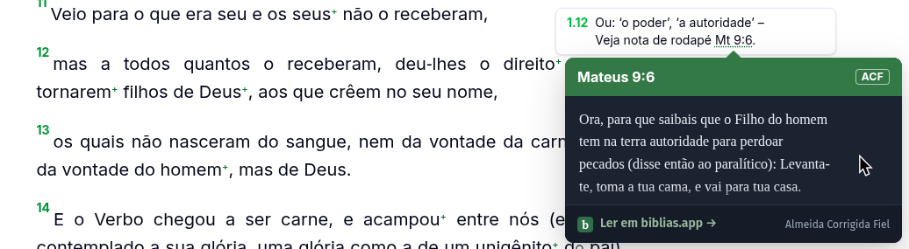

# Bible References

Detecta referências bíblicas em textos, transforma-as em links e mostra a passagem em um tooltip. Funciona em páginas HTML e aplicações React.



Por padrão, os textos são buscados no [biblias.app](https://biblias.app), na tradução Almeida Corrigida Fiel (ACF). O tooltip mostra os versículos completos, com rolagem, tema claro ou escuro e um link para continuar a leitura.

## Funcionalidades

- Referências em português, com nomes e abreviações dos 66 livros.
- Versículos, intervalos, listas e capítulos inteiros: `Jo 3:16`, `1Co 13:4-7`, `Sl 119:1-20,29,32` e `Sl 117`.
- Previews por mouse, toque e teclado.
- Detecção de conteúdo adicionado ou alterado na página.
- Seletores para limitar a busca a artigos, comentários ou outras partes do conteúdo.
- Integração com React e suporte a tooltips dentro de modais.

## Instalação

Para instalar a versão preliminar pelo npm, use a tag `next`:

```fish
bun add @coisasdoalto/bible-references@next
```

Importe também o CSS da biblioteca. Ele contém os estilos necessários para os links e tooltips; você não precisa instalar Tailwind.

React é opcional. A integração React requer a versão 18 ou superior.

## HTML e JavaScript

Monte a biblioteca no elemento que contém o texto:

```ts
import { mountBibleReferences } from "@coisasdoalto/bible-references";
import "@coisasdoalto/bible-references/style.css";

const bibleReferences = mountBibleReferences(document.body);
```

Referências como estas passam a abrir o preview:

```text
João 3:16
Jo 3:16
Jo. 3:16
Jo 3.16
1 Co 13:4
1Co 13:4
1 Coríntios 13:4-7
Sl 119:1-20,29,32,34,37-40
Sl 117
Salmos 119
```

Links existentes, botões, controles de formulário, conteúdo editável e os elementos `script`, `style`, `code` e `pre` são ignorados. Para ignorar outra região, adicione `data-bible-references-ignore` ao elemento.

### Conteúdo dinâmico

Use `observe: true` quando o texto puder chegar ou mudar depois da montagem. Combine com `selector` para buscar referências apenas em partes da página:

```ts
const bibleReferences = mountBibleReferences(document.body, {
  selector: "article, .comment",
  observe: true,
});
```

O seletor é aplicado dentro do elemento informado. Sem `selector`, todo o conteúdo desse elemento é examinado. Seletores inválidos lançam um erro na montagem.

Mudanças em atributos, como adicionar uma classe usada pelo seletor, precisam de uma atualização manual. Quando encerrar o uso da biblioteca, chame `destroy()`:

```ts
// Para varrer de novo manualmente (por exemplo, depois de mudar atributos):
bibleReferences.refresh();

// Remove listeners/tooltips e restaura o texto dos links criados:
bibleReferences.destroy();
```

### Usar somente o parser

Para identificar referências sem modificar a página:

```ts
import { parseBibleReferences } from "@coisasdoalto/bible-references";

const references = parseBibleReferences("Leia Romanos 1:1-8 e João 3:16.");
```

## React

Envolva a região com texto bíblico em um `BibleReferencesProvider`. Ele acompanha o conteúdo que chega ou muda depois, inclusive atualizações de estado e respostas de API:

```tsx
import { BibleReferencesProvider } from "@coisasdoalto/bible-references/react";
import "@coisasdoalto/bible-references/style.css";

export function Article({ text }: { text: string }) {
  return (
    <BibleReferencesProvider>
      <p>{text}</p>
    </BibleReferencesProvider>
  );
}
```

Você também pode restringir a busca com `<BibleReferencesProvider selector=".bible">`. Prefira envolver a região que contém o texto bíblico para reduzir o conteúdo examinado.

O provider aceita as opções de `mountBibleReferences`, com observação de conteúdo sempre habilitada. Mantenha `provider` e `getHref` estáveis, por exemplo fora do componente ou com `useMemo` e `useCallback`: mudar essas props recria a integração.

Alguns cuidados ao integrar:

- Use um provider por região, sem aninhar providers.
- Os links e tooltips aparecem no navegador, após a montagem. O HTML gerado no servidor sai sem eles.
- O wrapper usa uma `div` com `display: contents`. Isso preserva o layout, mas afeta seletores de filhos diretos como `.pai > p`. Use `as`, `className` e `style` para ajustar o elemento à sua página.
- Não chame `normalize()` nos elementos do provider: a biblioteca divide nós de texto para inserir os links. Veja os casos de integração documentados na [issue #8](https://github.com/coisasdoalto/bible-references/issues/8).

## Opções

Estas opções podem ser passadas a `mountBibleReferences` ou ao `BibleReferencesProvider`, com as diferenças indicadas:

| Opção       | Uso                                                               | Padrão                                |
| ----------- | ----------------------------------------------------------------- | ------------------------------------- |
| `selector`  | Restringe a busca aos elementos que correspondem ao seletor.      | Toda a região montada                 |
| `observe`   | Acompanha conteúdo adicionado ou alterado; disponível na API DOM. | `false`; sempre habilitado no React   |
| `preview`   | Habilita o tooltip com o texto da passagem.                       | `true`                                |
| `theme`     | Escolhe `"auto"`, `"light"` ou `"dark"`.                          | `"auto"`, acompanha o sistema         |
| `container` | Define onde o tooltip é anexado.                                  | `document.body`                       |
| `openIn`    | Abre o link do rodapé em `"new-tab"` ou `"current-tab"`.          | `"new-tab"`                           |
| `getHref`   | Define o endereço do link da referência.                          | Página de leitura no biblias.app      |
| `provider`  | Fornece os textos das passagens.                                  | Provider do biblias.app, tradução ACF |

### Modais e popovers

Em modais, passe um `container` dentro do próprio modal para permitir cliques, toques e rolagem no tooltip:

```ts
mountBibleReferences(noteElement, { container: noteElement });
```

No React, `container` aceita um elemento ou um `ref`. Se o elemento puder mudar sem o provider renderizar novamente, passe o próprio elemento, mantido em estado por um callback ref.

O tooltip usa a camada superior do navegador quando a Popover API está disponível. O posicionamento suporta ancestrais com translação e escala; rotação e skew não são suportados.

### Outros providers

Implemente `PassageProvider` para buscar os textos de outra fonte. O método `getPassage(reference, signal?)` recebe a referência e retorna a passagem. Os campos opcionais `translation` e `source` definem a identificação da tradução e o link de leitura do rodapé.

O provider padrão também pode ser criado com `createBibliasAppPassageProvider()`.

## Interação com o preview

Clique ou toque na referência abre o tooltip. No desktop, ele também abre ao passar o mouse ou navegar até o link com `Tab`. O clique na referência abre o preview; a navegação para a passagem fica no link do rodapé.

O preview permanece aberto enquanto o link ou tooltip estiver sob o ponteiro ou com foco. Com o link focado, pressione `↓` para entrar na área da passagem e usar as teclas de rolagem. `Escape` fecha o preview e devolve o foco ao link.

Rolar a página ou tocar fora fecha o preview. Rolar dentro dele mantém a passagem aberta. O foco programático, como o foco inicial de um diálogo, não abre o tooltip.

## Aparência

Use `theme` para escolher o tema e variáveis CSS para adaptar as cores e dimensões ao seu site. As principais são:

| Variável                                                   | Ajuste                                                       |
| ---------------------------------------------------------- | ------------------------------------------------------------ |
| `--br-accent`                                              | Cor de destaque                                              |
| `--br-reference-color`                                     | Cor da referência no texto                                   |
| `--br-tooltip-width`                                       | Largura do tooltip, limitada à tela                          |
| `--br-tooltip-max-height`                                  | Altura máxima do tooltip; padrão de `24rem`, limitada à tela |
| `--br-tooltip-radius`                                      | Arredondamento dos cantos                                    |
| `--br-tooltip-background` / `--br-tooltip-color`           | Fundo e texto                                                |
| `--br-tooltip-font-family` / `--br-tooltip-ui-font-family` | Fontes da passagem e da interface                            |

Para ajustes mais específicos, também estão disponíveis `--br-tooltip-muted-color`, `--br-tooltip-header-background`, `--br-tooltip-header-color`, `--br-tooltip-footer-background`, `--br-tooltip-border-color`, `--br-tooltip-link-color` e `--br-tooltip-verse-number-color`.

## Exemplos e desenvolvimento

Os exemplos [vanilla](examples/vanilla) e [React](examples/react) usam a biblioteca do próprio repositório. Cada diretório inclui instruções para executar o exemplo.

Para desenvolver a biblioteca, instale as ferramentas com [mise](https://mise.jdx.dev) e execute:

```fish
mise install
mise run setup
mise run dev
```

Use `mise run check` para executar lint, tipos, testes, build e validação do pacote. `mise run fix` aplica as correções automáticas disponíveis.

## Licença

[MIT](LICENSE)
